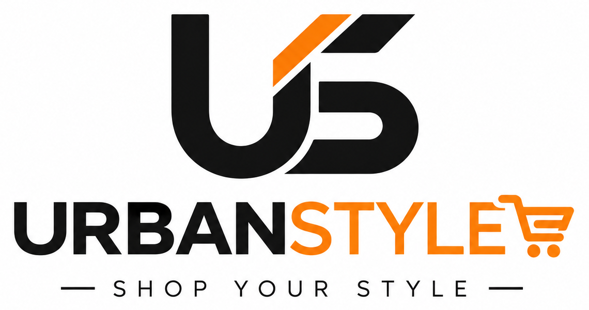

# UrbanStyle - E-Commerce Fashion & Lifestyle Platform



> **UrbanStyle — Shop Your Style**  
> A modern, responsive multi-category fashion and lifestyle e-commerce web platform.

---

## 🛍️ Overview

**UrbanStyle** is an end-to-end frontend e-commerce web application delivering a seamless online shopping experience across diverse categories including Men's Fashion, Women's Wear, Kids' Apparel, Home & Living, and Beauty essentials. Featuring branded promotional slider campaigns, dynamic product showcases, responsive navigation, user registration, checkout workflows, and instant order placement confirmations.

---

## ✨ Features & Highlights

- **Branded Navigation Bar**: Clean responsive header with the **UrbanStyle** monogram logo, category navigation, real-time search field, and quick access to login and shopping cart.
- **Hero Promotional Slider**: Interactive Bootstrap carousel featuring campaign banners (*Be Extraordinary Every Day*, *UrbanStyle Is Your Own Big Fashion Team*, and *Try & Buy*).
- **Exclusive Welcome Offers**: Promotional strip banner offering Flat ₹300 off on first purchase via the UrbanStyle App.
- **Comprehensive Product Catalogues**:
  - 👔 **Men's Fashion** ([`mens page1.html`](mens%20page1.html), [`mens page2.html`](mens%20page2.html)) — Shirts, jackets, casuals, and trending menswear.
  - 👗 **Women's Collection** ([`womens.html`](womens.html)) — Ethnic wear, modern dresses, and seasonal trends.
  - 🧒 **Kids' Corner** ([`kids.html`](kids.html)) — Comfortable everyday and party wear for kids.
  - 🏡 **Home & Living** ([`home.html`](home.html)) — Bed linens, decor, furnishings, and home essentials.
  - 💄 **Beauty & Care** ([`beauty.html`](beauty.html)) — Cosmetics, skincare, and grooming accessories.
- **Interactive Shopping Workflows**:
  - Product cards with pricing, discounts, and "Buy Now" / "Add to Cart" interactions.
  - **Shipping Details Form** ([`form.html`](form.html)) — Customer name, city, email, contact, and address input.
  - **Order Confirmation** ([`orderPlaced.html`](orderPlaced.html)) — Order placed screen with animated success badge.
- **User Authentication**: Sign-up and profile registration ([`signin.html`](signin.html)).
- **Company & Support Pages**:
  - **About UrbanStyle** ([`about us.html`](about%20us.html)) — Company vision, journey, and milestones.
  - **Contact Us** ([`Contact Us.html`](Contact%20Us.html)) — Direct feedback and customer support form.

---

## 🛠️ Tech Stack

- **Markup & Structure**: HTML5
- **Styling**: Vanilla CSS3, Bootstrap 5.3.3
- **Scripting & Interactivity**: JavaScript (ES6+), jQuery 3.7.1
- **Icons & Typography**: FontAwesome 6.6.0, Google Fonts (Lato, Source Sans Pro)

---

## 📂 Project Structure

```text
Myntra / UrbanStyle
├── index.html                   # Homepage with hero slider and promotional banners
├── mens page1.html              # Men's clothing catalogue (Page 1)
├── mens page2.html              # Men's clothing catalogue (Page 2)
├── womens.html                  # Women's fashion collection
├── kids.html                    # Kids' fashion collection
├── home.html                    # Home & Living store
├── beauty.html                  # Beauty & personal care collection
├── signin.html                  # User sign up / registration
├── form.html                    # Checkout shipping details form
├── orderPlaced.html             # Order placed confirmation screen
├── about us.html                # About UrbanStyle story and background
├── Contact Us.html              # Customer support & contact form
├── README.md                    # Project documentation
└── assest/
    ├── css/
    │   ├── content.css          # Product card styles
    │   ├── footer.css           # Global footer layout
    │   ├── orderPlaced.css      # Order status styles
    │   ├── style.css            # Registration form styles
    │   └── stylemy.css          # Core navbar and banner layout
    ├── js/
    │   └── orderPlaced.js       # Order API mock request handler
    └── images/
        ├── urbanstyle-logo.png  # Header & navbar logo
        ├── urbanstyle-favicon.png # Browser tab icon
        ├── UrbanStyle Monogram Shopping Logo.png # Master high-res brand logo
        ├── image1.cms           # Slider banner 1 (UrbanStyle Hero)
        ├── image2.jpg           # Slider banner 2 (UrbanStyle Fashion Team)
        ├── image3.jpg           # Slider banner 3 (Try & Buy Campaign)
        ├── offer2.png           # Flat 300 OFF App Banner
        └── ...                  # Product photography & assets
```

---

## 🚀 Getting Started

1. **Clone the repository**:
   ```bash
   git clone https://github.com/Vaibhav112027/myntra.git
   cd myntra
   ```

2. **Run locally**:
   - Simply double-click `index.html` to open in any modern web browser, or:
   - Use a lightweight local server:
     ```bash
     # Using Python
     python -m http.server 8000
     ```
   - Open [http://localhost:8000](http://localhost:8000) in your browser.

---

## 👥 Authors & Credits

- **Vaibhav Dadhich** & **Vikas Bahrod**
